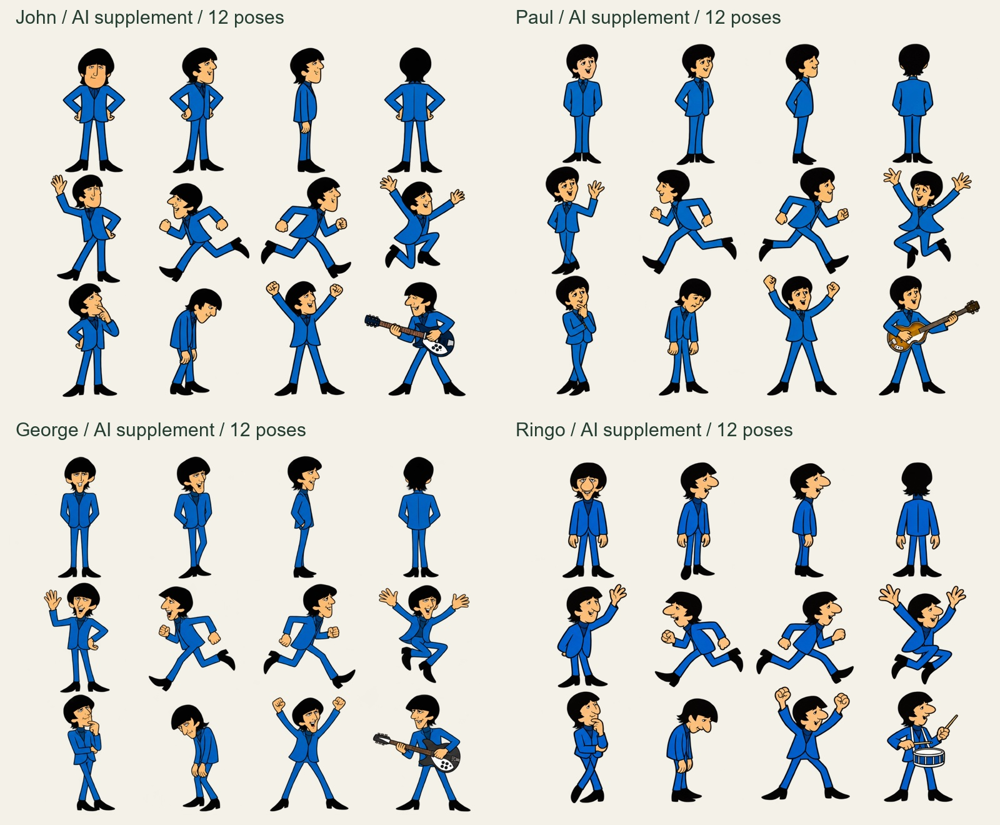

# Beatles 1965 Pet Resources

以 1965 年《The Beatles》电视动画中的 John、Paul、George、Ringo 为参考，整理的角色制作素材。

## 浏览素材

下载或克隆仓库后，用浏览器打开 [index.html](index.html)。可以按角色、网络原图和 AI 补充图筛选，点击图片查看或下载原尺寸文件。

- **21 张网络原图**：原片画面、原始制作赛璐珞稿照片、宣传图与角色设定复刻，其中 6 张低清画面仅作补充。
- **4 张透明 PNG 参考图**：每位角色 12 个姿势，共 48 个姿势画面；使用内置 Image Generation，根据历史资料补充生成。
- **来源与制作记录**：来源网页、图片地址、像素尺寸、文件校验值、生成提示词及修正记录。

## 四位角色

| 角色 | 素材索引 | 最终透明参考图 |
| --- | --- | --- |
| John Lennon | [John 索引](characters/john/index.html) | [John PNG](generated/john-reference-sheet-v2.png) |
| Paul McCartney | [Paul 索引](characters/paul/index.html) | [Paul PNG](generated/paul-reference-sheet-v2.png) |
| George Harrison | [George 索引](characters/george/index.html) | [George PNG](generated/george-reference-sheet.png) |
| Ringo Starr | [Ringo 索引](characters/ringo/index.html) | [Ringo PNG](generated/ringo-reference-sheet-v2.png) |

每张生成参考图采用 4 列 × 3 行：

1. 正面、四分之三角度、侧面、背面。
2. 挥手、向左跑、向右跑、跳跃。
3. 思考等待、失落、庆祝、演奏乐器。

背面及部分动作属于生成推演，不能作为历史资料。素材尚未制作为可直接导入 ChatGPT Pet 的动画精灵图。

## 目录

| 路径 | 内容 |
| --- | --- |
| `originals/` | 原样保存的网络图片，未放大、重新上色或 AI 修复 |
| `generated/` | 最终选用的四张透明 PNG 补充图 |
| `characters/` | 每位角色的来源索引和辨认说明 |
| `previews/` | 原图缩略总览和生成图总览 |
| `materials-manifest.json` | 最终素材选择、用途、类型和文件校验值 |
| `sources.json` | 所有网络来源和下载记录 |
| `generation-prompts.json` | 初始生成任务、提示词及参考图相对路径 |
| `generation-repairs.json` | John、Paul、Ringo 正面脸型修正提示词 |
| `qa-summary.json` | 素材数量、透明通道和检查记录 |

`collect_sources.py`、`collect_screenshots.py` 用于下载参考素材；`make_previews.py`、`package_materials.py` 用于生成浏览索引、检查总览与 ZIP 包。脚本依赖 Python 3 和 Pillow；图像生成通过内置 Image Generation 完成，下载与打包脚本不会重新生成角色图。

## 来源与清晰度

优先使用原片画面，并以更清晰的原始动画稿照片补充姿势和轮廓。赛璐珞稿照片所搭配的印刷背景不一定是播出版本的原背景。文件像素尺寸不代表真实高清片源，本仓库不宣称经过高清或 4K 修复。

`historical-model-sheet.jpg` 是标注 2007 年的授权赛璐珞复刻参考，呈现早期角色设定，不是 1965 年原件扫描。逐张来源请查阅 [sources.json](sources.json)。

原始图片与角色版权归各权利人所有；本仓库的下载和来源记录不表示获得开放许可。AI 补充图已经与历史来源明确区分。

整理日期：2026-11-01。
