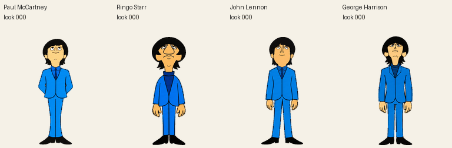

# Beatles Pet 最终成果

本目录保存 George Harrison、Paul McCartney、Ringo Starr、John Lennon 的最终 v2 精灵图与必要制作资料。来源为仓库已有的 1965 年动画角色参考，不是历史原片帧。

| 角色 | 最终精灵图 | 制作记录 | 最终验证报告 |
| --- | --- | --- | --- |
| Paul McCartney | [PNG](paul/spritesheet.png) | [提示词与来源](paul/generation.json) | [JSON](paul/validation.json) |
| Ringo Starr | [PNG](ringo/spritesheet.png) | [提示词与来源](ringo/generation.json) | [JSON](ringo/validation.json) |
| John Lennon | [PNG](john/spritesheet.png) | [提示词与来源](john/generation.json) | [JSON](john/validation.json) |
| George Harrison | [PNG](george/spritesheet.png) | [提示词与来源](george/generation.json) | [JSON](george/validation.json) |

每张 PNG 为 1536 × 2288、8 列 × 11 行，单格 192 × 208。九种动作分别为待机、向右跑、向左跑、挥手、跳跃、失落、等待输入、工作思考和检查；最后两行为十六个顺时针视线方向。共 73 个有效格、15 个透明空格。完整帧数、时长和 SHA256 见 [manifest.json](manifest.json)，其中路径均相对于仓库根目录。

## 四人预览

顺序为 Paul、Ringo、John、George。

- [动作 MP4](previews/beatles-quartet-animations.mp4)
- [视线循环 GIF](previews/beatles-quartet-look-loop.gif)：16 帧、一遍 2.88 秒，无限循环播放。
- [视线循环 MP4](previews/beatles-quartet-look-loop.mp4)：连续两遍，共 5.76 秒。



## 校验与重渲染

需要 Python 3.10+、Pillow；重渲染还需要 PATH 中有 FFmpeg 与 ffprobe。

```sh
python3 -m pip install -r pets/requirements.txt
python3 pets/render_previews.py --check
python3 pets/render_previews.py --output-dir /tmp/beatles-pet-previews
```

脚本从自身位置查找仓库和资源，不依赖运行时工作目录。默认输出到 `pets/previews/`，已有文件时拒绝覆盖；明确使用 `--force` 可重渲染并同步清单中的校验值。`--look-mp4-loops 2` 为默认设置，仅影响视线 MP4；GIF 保持一遍序列无限循环。MP4 以 100 fps 重复持有原始精灵帧，精确保留 10 ms 整数倍的帧时长，不生成额外动作姿势。重渲染结果不保证与历史编码逐字节相同。

## 提示词与质量记录

各角色目录中的 `generation.json` 指向本仓库已有的全身与头部参考、角色约束及分任务提示词。`selected-generation-prompt` 是选中图对应的已保存提示词；`prepared-job-template` 是制作前准备的任务模板，不冒充逐字记录的最终调用。左跑由批准的右跑帧逐帧镜像，时间顺序不变；没有乐器或持有道具的手性问题。

提示词所需的 canonical base、布局 guide、九行 contact sheet、四方向锚点及上一视线行是在制作工作区中逐步生成的依赖，不属于本精简归档。重制新帧时需重新建立这些依赖，并重新进行完整校验；此处的渲染脚本只使用最终精灵图生成预览，不调用图像生成服务。

`validation.json` 保留创建前最终字节的结构、质量、方向语义、连续性、Pets 预检及独立盲审证据。只将原本机文件路径改为归档路径，精灵图 SHA256 保持不变。部分中间方向角度或像素连续性有已目视复核的软警告，详情在报告中，四个正方向均通过。

失败草稿、原始生成 strip、逐帧缓存、重复参考图、日志及账号 Pet ID 不放入本归档。只要保留最终精灵图，就能用于重新上传；具体导入能力取决于客户端支持的格式。
